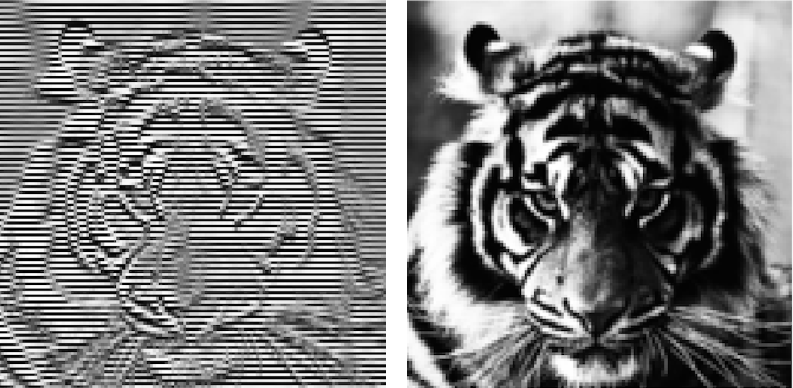
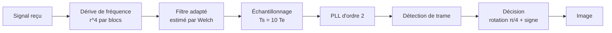
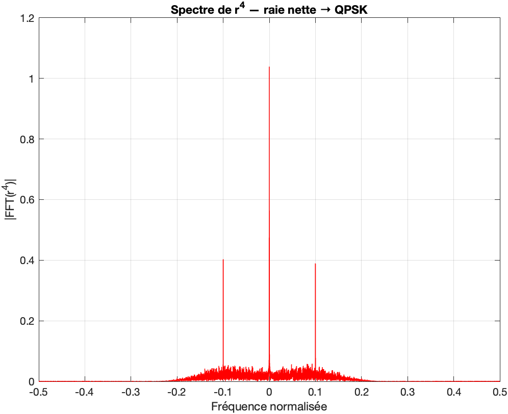
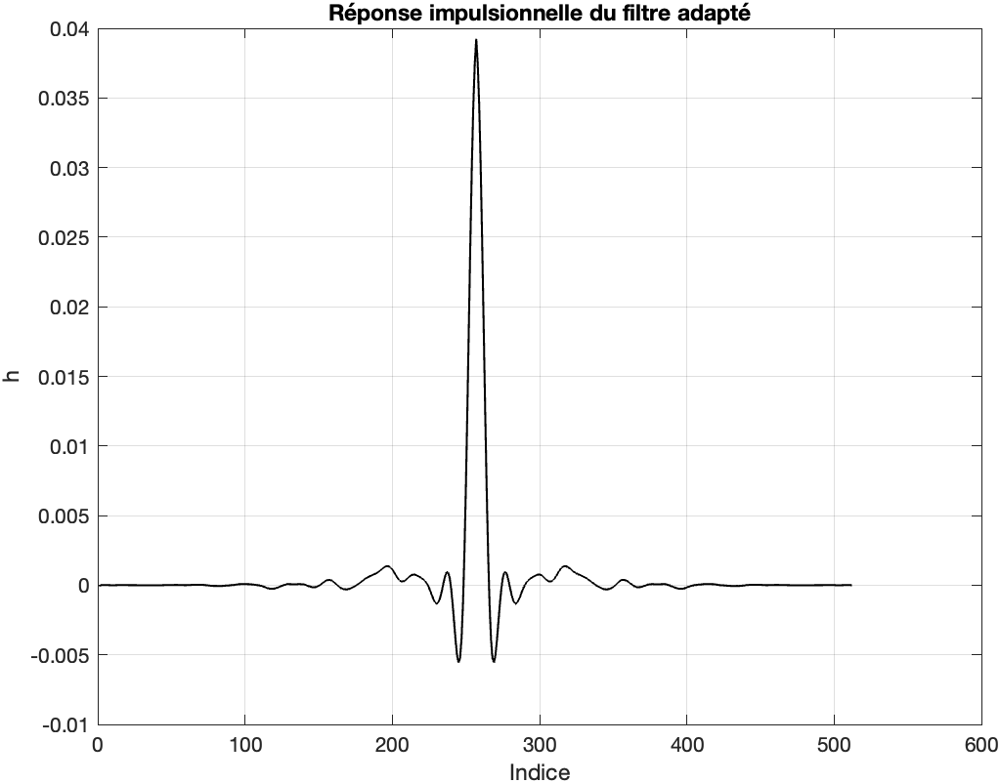
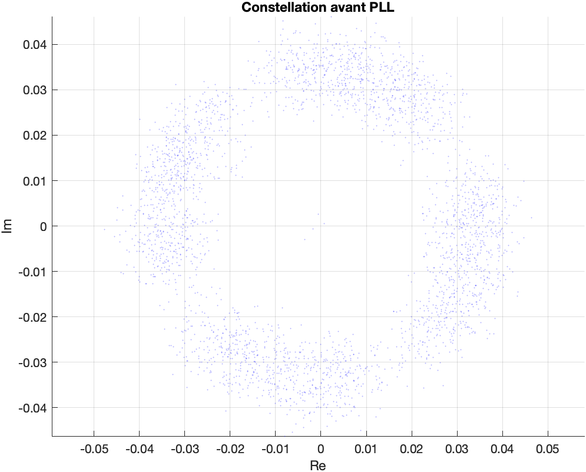
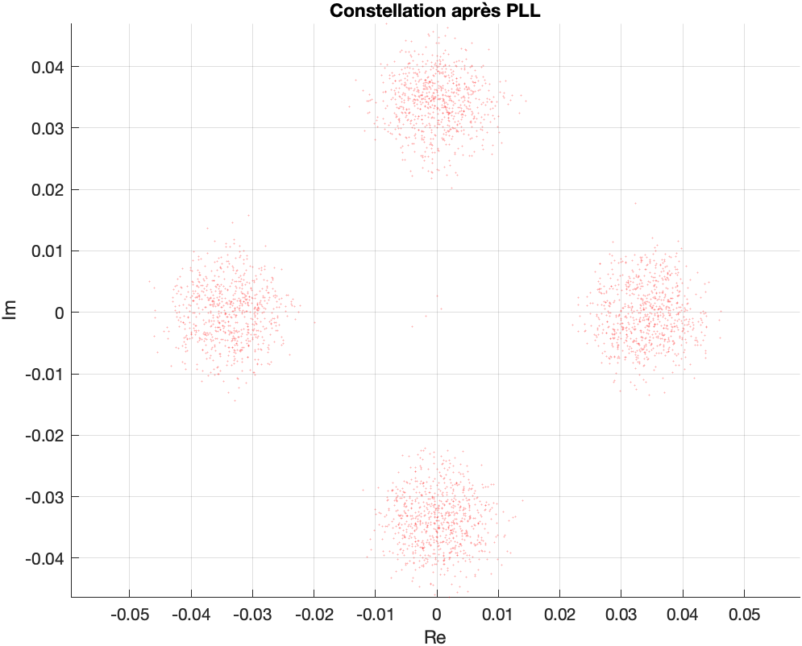
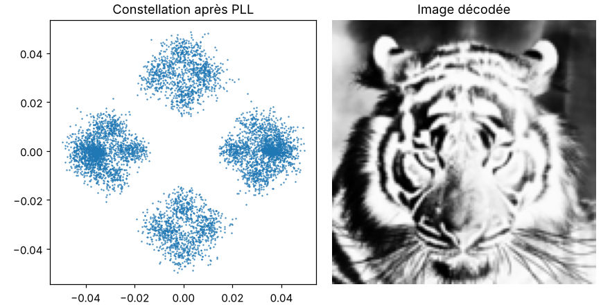

# Récepteur QPSK : décoder une image à partir d'un signal intercepté

Un signal radio inconnu a été enregistré. On sait seulement qu'il contient une image. Il faut retrouver, sans aucune information de l'émetteur, la modulation, le rythme des symboles, le filtre d'émission et le décalage de fréquence, puis décoder les bits.



*À gauche, la première version : la chaîne est correcte, mais l'image est rayée. À droite, après correction de l'étape de décision.*

| | |
|---|---|
| Cadre | projet du module TS218 (traitement du signal), ENSEIRB-MATMECA, 2e année Télécommunications |
| Date | mars 2026 |
| Outils | MATLAB (Signal Processing Toolbox) ; vérification en Python (NumPy, SciPy) |
| Entrée | 893 917 échantillons complexes en bande de base |
| Sortie | image de 128 × 128 pixels (65 536 symboles QPSK) |

## La chaîne de réception



**1. Identifier la modulation.** Élever le signal à la puissance M efface une modulation M-PSK. Avec r^4, une raie nette apparaît : c'est du QPSK, 2 bits par symbole.



**2. Mesurer la dérive de fréquence.** La phase de la somme de r^4 sur des blocs de 1 000 échantillons, déroulée, donne le décalage de fréquence au cours du temps. Il n'est pas constant.

**3. Estimer le filtre d'émission à l'aveugle.** Les symboles étant décorrélés, la densité spectrale du signal reçu est proportionnelle à |H(f)|². Sa racine (périodogramme de Welch) puis une transformée inverse donnent h(t), et le filtre adapté est h*(-t).



**4. Trouver le rythme symbole.** Le spectre de |r|² présente une raie à f = 0,1 : il y a 10 échantillons par symbole. Sur les 10 positions possibles, on garde celle qui tombe sur les maxima du signal filtré.

**5. Corriger la phase avec une PLL d'ordre 2.** Une boucle d'ordre 1 ne corrige qu'une phase fixe. Ici la constellation tourne à vitesse variable, il faut aussi suivre la fréquence. Détecteur d'erreur QPSK : Im((s/|s|)^4), avec α = 0,1 et β = 10⁻⁴.

| Avant la PLL | Après la PLL |
|---|---|
|  |  |

**6. Isoler la trame.** Les symboles utiles sont ceux dont l'amplitude dépasse 20 % du maximum : on en retrouve exactement 65 536, soit 128 × 128 pixels de 8 bits.

**7. Décider les bits.**

## Le problème, et ce qui l'a résolu

La première version décidait chaque symbole d'après son angle, avec des frontières à 0°, 90°, 180° et 270°. Or après la PLL, les symboles sont centrés exactement sur ces axes : les frontières passaient au milieu des nuages de points, et le moindre bruit faisait basculer la décision. D'où les lignes sur l'image.

La correction : tourner la constellation de π/4, puis lire simplement le signe de la partie réelle et de la partie imaginaire. Chaque symbole est alors à 45° de la frontière la plus proche. La PLL laisse une ambiguïté de rotation de π/2 et l'ordre des deux bits n'est pas connu : on teste les 8 combinaisons et on garde l'image la plus régulière.

Leçon retenue : chaque bloc de la chaîne fonctionnait, mais l'alignement entre la constellation et le détecteur était faux.

## Contenu du dépôt

```
qpsk-receiver/
├── recepteur_qpsk.m          chaîne complète, version finale
├── original/                 scripts écrits pendant le projet (exploration, versions successives)
├── verification_python/      réplique Python de la chaîne, pour la vérifier sans MATLAB
├── docs/presentation.pdf     présentation du projet, 20 pages
├── docs/img/                 figures
└── data/                     emplacement du signal (non publié)
```

Lancer : placer `signal_recu.mat` dans `data/`, puis exécuter `recepteur_qpsk.m` depuis la racine du dépôt. En Python : `python verification_python/recepteur_miroir.py data/signal_recu.mat`.

`recepteur_qpsk.m` rassemble en un seul script la chaîne décrite dans la présentation (octobre 2026). La réplique Python, exécutée sur le vrai signal, retrouve la trame (symboles 5 à 65 540) et l'image ci-dessous.



---

Yanis Djelali, élève ingénieur en télécommunications, ENSEIRB-MATMECA.
